  

  
  

## About

Frontend developer focused on building clean, responsive interfaces for web and mobile. I have shipped a full event-management product (web + React Native app on Google Play) and built WooCommerce / Elementor sites for clients, including German e-commerce shops. When the team needs it, I also take care of the backend side — WordPress, custom plugins and REST APIs.

## Tech stack

<table>
  <tr>
    <td><b>Languages</b></td>
    <td>    </td>
  </tr>
  <tr>
    <td><b>Frontend</b></td>
    <td>    </td>
  </tr>
  <tr>
    <td><b>Mobile</b></td>
    <td> </td>
  </tr>
  <tr>
    <td><b>CMS & Backend</b></td>
    <td>     </td>
  </tr>
  <tr>
    <td><b>Tools</b></td>
    <td>   </td>
  </tr>
</table>

## Experience

**Frontend Developer** · Webie Global · 12/2025 – 10/2026

- Built the complete UI of an event management system — web app and React Native mobile app — through to Google Play release.
- Developed and maintained WooCommerce stores for German clients: B2C/B2B setup, custom product fields, bug fixing, performance tuning.
- Delivered corporate websites with WordPress + Elementor: responsive layouts and on-page SEO.

**Education** · Bachelor of IT (Software Technology) · Van Lang University · 2021 – 2025

## Projects

- **[Portfolio](https://phjn.vercel.app)** — personal portfolio site, deployed on Vercel.
- **[VietQR Checkout](https://github.com/PhjnX/vietqr-checkout)** — WooCommerce payment plugin that generates VietQR codes at checkout.

## Activity

  

---

More about me at <a href="https://phjn.vercel.app">phjn.vercel.app</a>

